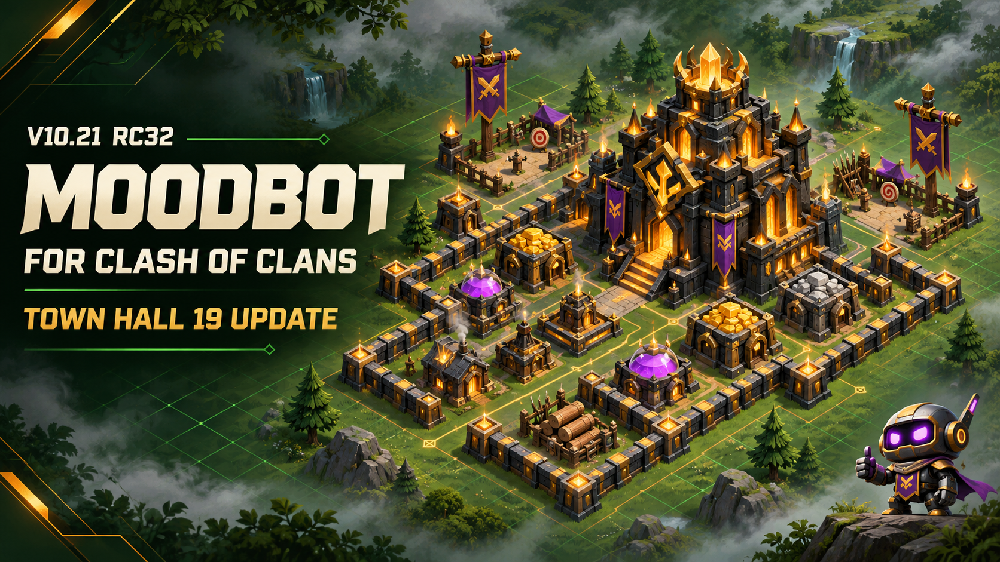

  

<h1 align="center">MoodBot V10.21 RC32</h1>

<strong>Clash of Clans automation for Windows, LDPlayer and ADB</strong>

  <a href="https://miichmood.github.io/MoodBot-Website/"><strong>Official website</strong></a>
  &nbsp;|&nbsp;
  <a href="docs/MoodBot_V10.21_RC32_Manuale_Interattivo.pdf"><strong>Interactive user manual</strong></a>
  &nbsp;|&nbsp;
  <a href="docs/README.md"><strong>Documentation index</strong></a>

> [!IMPORTANT]
> This is the public documentation for MoodBot. Contact support for the Windows package and a hardware-bound license.

## Overview

MoodBot runs farming sessions in LDPlayer over local ADB. It compares available loot with your active filters, replays eligible presets for the selected Town Hall group and checks for recognized cards still available after deployment.

### What’s new in RC32

- Filter by gold, elixir and dark elixir. When wall upgrades are off, verified storage space can change which resources MoodBot targets. The session ends and closes the game when all storages are confirmed full.
- MoodBot checks remaining hero, troop, spell and reinforcement cards. It tries open points near the map edge for recognized units and aims spells near the center. If recorded slots differ from the visible army bar, it can deploy the cards it recognizes directly.
- The recorder uses the selected interface language. Settings, recording, activity and subscription screens are illustrated in all eight manual languages.

## Main features

| Feature | How it works |
| --- | --- |
| Loot search | Apply any combination of the three resource filters. Matching bases must meet the active thresholds. The reader handles displayed 2× and 3× loot bonuses. |
| Attack presets | Six groups cover TH 1–6 through TH 13+. MoodBot can choose a saved pattern for the selected group. |
| Battle speed | Requests 4× only when the in-game control is available. |
| Optional wall upgrades | Set an attack interval for wall checks. The default gold reserve is 50,000. |
| Session controls | Start, Pause, Resume and Stop, optional village pauses, session counters and a copyable Activity log. |
| Return and recovery | Verifies the return to the village and handles recognized rewards or connection prompts. |
| Licensing and appearance | MB3 code or `.mblic` file, localized Subscription dialog, light and dark themes. |

## Requirements

| Component | Configuration |
| --- | --- |
| Windows emulator | One LDPlayer instance with local ADB enabled |
| Resolution and density | 1600 × 900 at 240 DPI |
| Game language | English in Clash of Clans. Choose the MoodBot interface language independently. |
| Starting screen | Home village in standard scenery, with menus and dialogs closed |

## First setup

1. Extract the Windows package into a writable local folder and open `AVVIA_MOODBOT.bat`.
2. Copy your PC code (HWID) and send it to the license provider. Paste the MB3 code or import the `.mblic` file received for that computer.
3. Configure LDPlayer as above. Prepare your army, select its Town Hall group and choose your loot filters.
4. Start at the village and monitor Activity during the first session.

## Daily operation and recording

Keep your army and visible troop-bar order compatible with your preset. If your army changes substantially, record a new preset and check which cards are recognized. The [website’s army reference](https://miichmood.github.io/MoodBot-Website/#armies) lists example compositions for each group.

To record a pattern, stop the session, choose the Town Hall group and open **Record**. Open a battle manually in LDPlayer, press **Start** in the recorder and deploy in the game. Click **Stop and save** when the deployment is complete. The JSON file goes into the selected subfolder under `patterns/`. Record deployment actions only and keep search, zoom and return-to-village clicks out of the preset.

## Documentation and troubleshooting

The 33-page PDF includes setup, licensing, recording, wall upgrades and common recovery steps. Choose a language using its interactive index or the [documentation index](docs/README.md).

| Symptom | First check |
| --- | --- |
| LDPlayer or ADB unavailable | Open one emulator instance, enable local ADB and wait for the village to load. |
| Pattern unavailable | Check the Town Hall group and confirm that its `patterns/` folder contains a JSON preset. |
| Incorrect loot reading | Check English game language, standard scenery, resolution and overlays. |
| Cards left undeployed | Check the recorded troop-bar order and inspect Activity for unconfirmed cards. |
| An unexpected battle or dialog blocks the session | Stop the session, return to the village and copy Activity before restarting. |

## Availability and support

MoodBot is proprietary paid software. Contact [Telegram](https://t.me/michmood) or [email](mailto:moodbotcoc@gmail.com) for availability, licensing and support. Remove player names, clan names and license data from materials shared in public issues.

## Disclaimer

Automation can conflict with the game’s terms. MoodBot is an independent tool and is not affiliated with Supercell. Clash of Clans is a trademark of Supercell Oy. Game updates and new screens can affect recognition and compatibility.
